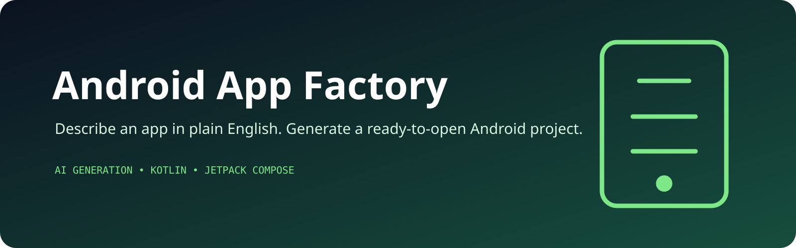

<p align="center">
  
</p>

# 🤖 Android App Factory

> **AI-powered Android app generator.** Describe your app in plain English — get a complete, ready-to-open Kotlin/Jetpack Compose Android Studio project in minutes.

A Windows desktop application built with Flutter that turns natural-language descriptions into fully scaffolded, compilable Android apps using large language models (MiniMax or Anthropic Claude).

---

## ✨ Features

### 🚀 App Generation
- Describe any Android app in plain English
- Two-pass LLM pipeline: **plan → code** for better quality output
- Generates complete **Kotlin + Jetpack Compose** source files
- Produces a ready-to-open **Android Studio project** with:
  - Full Gradle build system (`build.gradle.kts`, `settings.gradle.kts`, `libs.versions.toml`)
  - Android manifest, themes, string resources
  - Navigation, ViewModel, Material 3 — all wired up
  - Latest stable versions: AGP 8.13.2, Kotlin 2.3.0, Compose BOM 2025.11.00, Gradle 8.14.4

### 📖 App History
- Every generated app is saved to a local history (persisted as JSON in Documents)
- Browse past apps in a card grid — name, package, description preview, file count, timestamps
- One-click **Open in Android Studio** (auto-detects Android Studio and JetBrains Toolbox)
- **Delete** with optional disk removal (confirmation dialog)
- Up to 50 recent apps stored

### ✏️ AI-Powered App Updates
- Pick any past app and describe what to change
- **Smart patch mode** — LLM analyzes existing code and only rewrites the files that need changing (faster)
- **Full regeneration mode** — re-runs the full generation pipeline with the new requirements merged in
- Live progress log with per-file change tracking
- Update history tracked per app record

### 🖥️ Developer UX
- Real-time generation log with color-coded status messages
- Syntax-highlighted file browser (view generated code before opening in Studio)
- Progress bar across all generation phases
- One-click **Open in Android Studio** with Gradle sync option
- LLM provider indicator + configuration status in the top bar

---

## 📸 UI Overview

```
┌──┬────────────────────────────────────────────────────┐
│  │  Android App Factory          [MiniMax ✓] [3 apps] │
│  ├─────────────────────────────────┬──────────────────┤
│🔮│  Describe Your App              │  Generation Log  │
│  │  ┌──────────┐ ┌──────────────┐  │  🚀 Starting...  │
│📁│  │ App Name │ │ Package Name │  │  🧠 Planning...  │
│  │  └──────────┘ └──────────────┘  │  ⚡ Generating.. │
│🕐│  [Output directory...]  Browse  │  ✅ 12 files     │
│  │  ┌────────────────────────────┐ │  🎉 Done!        │
│  │  │ Describe your app here...  │ │  ───────────────  │
│  │  │                            │ │  📁 Open in      │
│  │  └────────────────────────────┘ │  Android Studio  │
│  │  [  🚀 Generate Android App  ]  │                  │
│⚙️│                                 │                  │
└──┴─────────────────────────────────┴──────────────────┘
```

**Three sidebar tabs:**
- **Generate** — Prompt form + live console
- **Output** — Browse and view generated files
- **History** — All past apps with update controls

---

## 🛠️ Tech Stack

| Layer | Technology |
|-------|-----------|
| **Desktop UI** | Flutter 3.11+ (Windows) |
| **State management** | Provider + ChangeNotifier |
| **HTTP client** | Dio |
| **Persistence** | shared_preferences + JSON file (path_provider) |
| **Code highlighting** | flutter_highlight (Monokai Sublime) |
| **LLM — Option A** | [MiniMax M2.7](https://www.minimax.io) (OpenAI-compatible API) |
| **LLM — Option B** | [Anthropic Claude Opus 4](https://www.anthropic.com) |
| **Generated apps** | Kotlin · Jetpack Compose · Material 3 · NavHost · ViewModel |

---

## 📦 Generated Project Stack

Every app generated by Android App Factory uses:

| Component | Version |
|-----------|---------|
| Android Gradle Plugin | 8.13.2 |
| Kotlin | 2.3.0 |
| Gradle Wrapper | 8.14.4 |
| Compose BOM | 2025.11.00 |
| Core KTX | 1.18.0 |
| Lifecycle (Runtime + ViewModel) | 2.10.0 |
| Activity Compose | 1.13.0 |
| Navigation Compose | 2.9.7 |
| compileSdk / targetSdk | 36 |
| minSdk | 26 (Android 8.0) |
| JVM toolchain | 17 (auto-detected/downloaded via foojay) |

The generated project is configured with the **foojay toolchain resolver** — if you don't have JDK 17 installed, Gradle will download it automatically on first build.

---

## 🚀 Getting Started

### Prerequisites

- Windows 10/11
- [Flutter SDK](https://docs.flutter.dev/get-started/install/windows) (≥ 3.11)
- An API key from either:
  - [MiniMax](https://www.minimax.io) — model: `MiniMax-M2.7`
  - [Anthropic](https://console.anthropic.com) — model: `claude-opus-4-20250514`

### Running from source

```bash
git clone https://github.com/benclawbot/android_app_factory.git
cd android_app_factory
flutter pub get
flutter run -d windows
```

### First-time setup

1. Click **⚙️ Settings** in the sidebar
2. Choose your LLM provider (MiniMax or Anthropic)
3. Paste your API key
4. Click **Save**

The status indicator in the top bar will show ✅ when configured.

---

## 🎯 How It Works

### Generation Pipeline (5 phases)

```
Phase 1: PLAN        [0% → 15%]
  LLM call #1 — architecture planning
  → screens, navigation flow, data models

Phase 2: CODE        [15% → 60%]
  LLM call #2 — full Kotlin/Compose code generation
  → uses the plan from Phase 1 as context

Phase 3: PARSE       [60% → 70%]
  Regex extraction of individual .kt files from LLM response
  → 3-level fallback parser for different output formats

Phase 4: SCAFFOLD    [70% → 90%]
  Static template files merged with generated code
  → build.gradle.kts, settings, manifest, themes, version catalog

Phase 5: WRITE       [90% → 100%]
  All files written to the chosen output directory
  → folder structure matches Android Studio conventions
```

### Smart Update Pipeline

```
Existing app files  ─┐
Update request       ├→ LLM  →  Changed files only  →  Patch disk  →  History updated
Original prompt     ─┘
```

The smart patch mode sends all existing `.kt` source files as context and asks the LLM to output **only the files that need to change** — keeping the round-trip fast and the diff minimal.

---

## 📁 Project Structure

```
lib/
├── main.dart                        # App entry, window config, Provider setup
├── models/
│   ├── llm_config.dart              # LLM provider enum + config
│   ├── generation_state.dart        # Immutable generation state
│   └── app_record.dart              # Saved app record + update history
├── providers/
│   ├── app_provider.dart            # Settings + SharedPreferences
│   ├── generation_provider.dart     # Generation state machine
│   └── history_provider.dart        # App history persistence
├── services/
│   ├── llm_service.dart             # Dual-provider LLM HTTP client
│   ├── project_generator.dart       # 5-phase generation pipeline
│   └── app_updater.dart             # Smart patch + full regen update service
├── templates/
│   └── android_templates.dart       # All static Android build file templates
├── theme/
│   └── app_theme.dart               # Dark theme + color constants
├── screens/
│   └── home_screen.dart             # Main layout (sidebar + top bar + tabs)
└── widgets/
    ├── sidebar.dart                  # Icon rail navigation
    ├── prompt_panel.dart             # Generation input form
    ├── console_panel.dart            # Real-time log viewer
    ├── file_tree_panel.dart          # Generated file browser
    ├── history_panel.dart            # App history card grid
    ├── update_dialog.dart            # AI update dialog
    └── settings_dialog.dart          # LLM configuration dialog
```

---

## 🔧 Configuration

All settings are persisted to `SharedPreferences`:

| Setting | Description |
|---------|-------------|
| LLM Provider | MiniMax or Anthropic |
| API Key | Your LLM API key |
| Custom Endpoint | Optional proxy/custom base URL |
| Output Directory | Default folder for new projects |

App history is stored as JSON at:
```
%USERPROFILE%\Documents\android_app_factory_history.json
```

---

## 💡 Usage Tips

### Writing good prompts

The more specific your description, the better the output. Include:
- **Screens**: "a home screen with a list of items, a detail screen, and an add-item form"
- **UI style**: "dark theme with blue accents", "card-based layout", "bottom navigation"
- **Features**: "local storage with Room", "pull-to-refresh", "search bar"
- **Data**: "each item has a title, description, and date"

**Example prompt:**
> A habit tracker app with a home screen showing today's habits as checkable cards, a progress screen with weekly streaks displayed as a bar chart, and an add-habit screen with name, frequency (daily/weekly), and reminder time. Use a clean minimal design with green accent colors.

### Using the AI updater

After generating an app, click **Update** on its history card and describe the change:
- `"Add a settings screen with dark mode toggle and notification preferences"`
- `"Replace the list layout with a grid of 2 columns"`
- `"Add swipe-to-delete on the main list"`
- `"Change the color theme to purple and dark background"`

Use **Smart patch** for targeted changes and **Full regeneration** when the structure needs to change significantly.

---

## ⚠️ Known Limitations

- **Windows only** — the desktop UI targets Windows; macOS/Linux builds are possible but untested
- **No touch controls in generated games** — keyboard-focused input (e.g., game controls) may not map well to touch; test on an emulator before deploying
- **LLM non-determinism** — output quality varies by prompt and model; re-generating with a refined prompt often improves results
- **No `gradle-wrapper.jar` bundled** — generated projects use minimal wrapper scripts; Android Studio handles bootstrapping automatically when you open the project
- **Sound/audio stubs** — generated apps may include SoundManager stubs without actual audio files; add your own assets
- **External library limits** — the code prompt restricts the LLM to Jetpack + Material 3; no third-party libraries (Retrofit, Coil, Room, etc.) unless you add them manually after generation

---

## 📜 License

MIT License — see [LICENSE](LICENSE) for details.

---

## 🙏 Acknowledgements

- [Flutter](https://flutter.dev) — cross-platform UI toolkit
- [MiniMax](https://www.minimax.io) — LLM provider
- [Anthropic](https://www.anthropic.com) — Claude LLM provider
- [Jetpack Compose](https://developer.android.com/jetpack/compose) — Android UI framework
- [flutter_highlight](https://pub.dev/packages/flutter_highlight) — syntax highlighting
